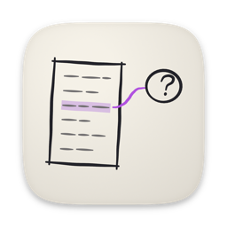
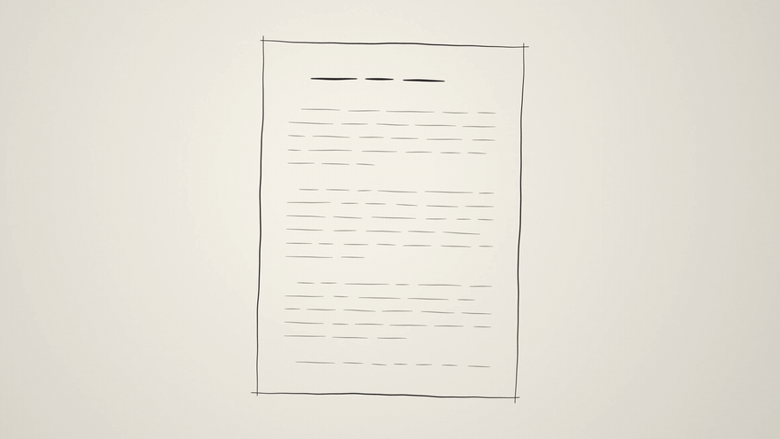
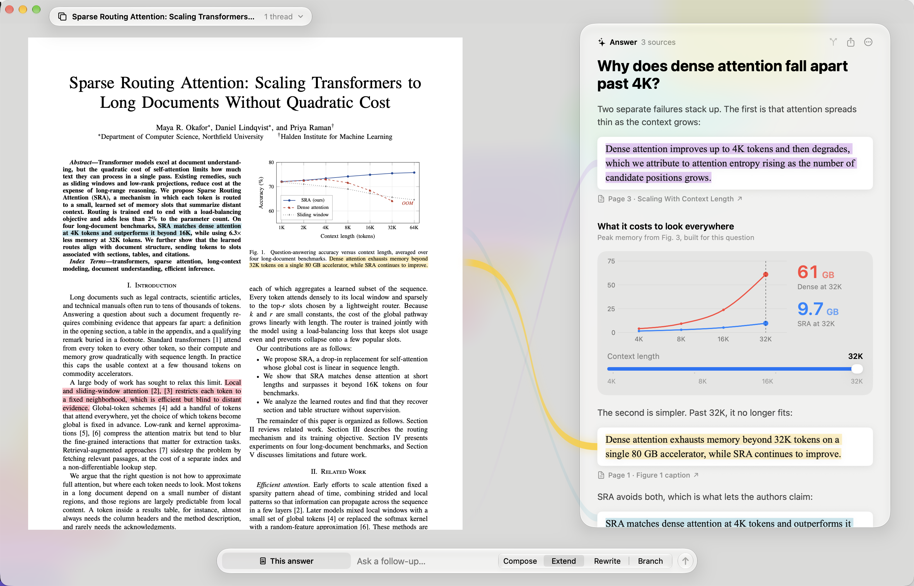
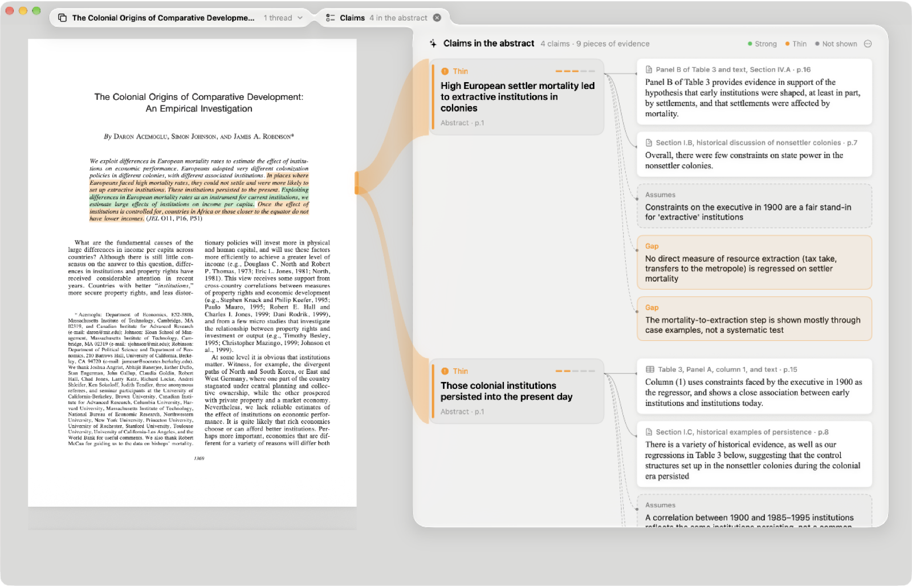
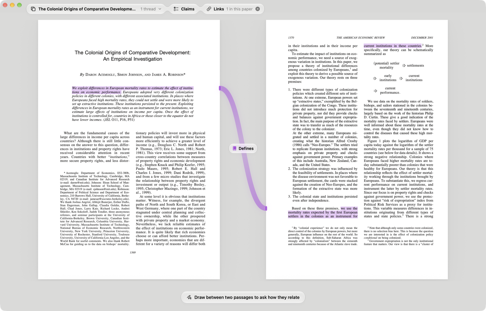
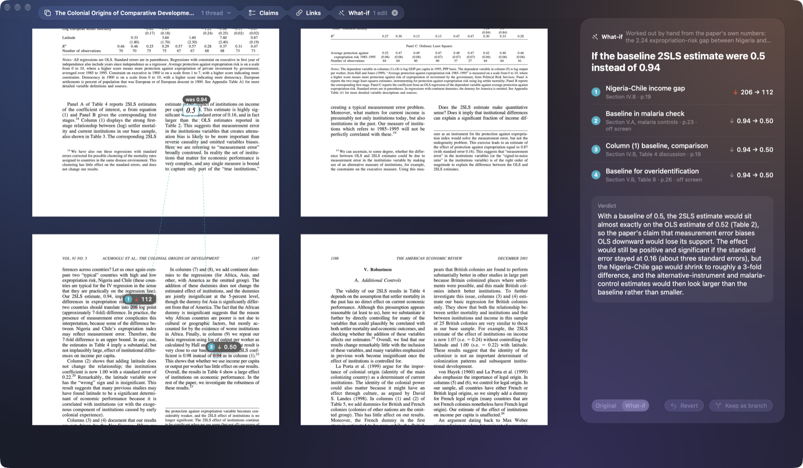

<p align="center">
  
</p>

<h1 align="center">Paper Companion</h1>

<p align="center">
  <b>Ask the paper.</b><br>
  A Mac app for reading research papers with Claude, where every answer is made from the paper's own words.
</p>

<p align="center">
  <a href="https://github.com/akassh9/paper-companion/releases/tag/film">
    
  </a>
  <br>
  <sub><a href="https://github.com/akassh9/paper-companion/releases/tag/film">▶ Watch the film</a> · 1 minute</sub>
</p>

<br>

<picture>
  <source media="(prefers-color-scheme: dark)" srcset="docs/screenshots/glass/7-dimmed.png">
  
</picture>

Select a passage, ask a question, and the answer appears beside the paper as a short composed page, not a
chat. Every quote in it is the paper's exact text, highlighted in the same color as its source and joined to
it by a beam. If a quote can't be found in the paper, it's marked, never linked.

One rule shapes the look: **what the authors wrote is paper; what the AI makes is glass.**

## Answers made from its own words

Ask about any passage. Follow up to extend the answer, rewrite it, or drag in another passage to branch it,
and the answer is rewritten to weave the new passage in. When a question needs numbers, Claude can run code
on the paper's tables and draw the figure the paper didn't include.

## See which claims hold up



**Map Claims** (⇧⌘K) pulls out the paper's claims and rates each one *strong*, *thin* or *not shown*. Each
claim is connected to the evidence the paper gives, the assumptions it rests on, and the gaps it leaves.

## Draw how ideas connect



**Draw Links** (⇧⌘L) lays the pages out side by side. Draw from one sentence to another, and Claude suggests
how they relate: *same as*, *supports*, *contradicts*, *defines* or *depends on*. You can keep its
suggestion, change it, or ask about the link.

## Change a number. See what follows.



**What If** (⇧⌘E) lets you edit a number in the paper. Claude traces what else would move, reading the
table pages themselves when it needs to, strikes through each affected value, and says whether the paper's
argument would still stand. It's an estimate, labeled as one. Keep it as a branch, or revert.

## Get started

You'll need macOS 26 or later, Xcode's Swift 6 toolchain, and a [Claude API key](https://console.anthropic.com/).

```bash
git clone https://github.com/akassh9/paper-companion.git
cd paper-companion
scripts/build-app.sh
open "build/Paper Companion.app"
```

Open a PDF (⌘O), or choose **File ▸ Open Sample Paper**. The first time you ask a question, the app asks for
your API key and keeps it in the Keychain. You can change it under **Paper Companion ▸ Claude API Key…**

| | |
|---|---|
| **View ▸ Model** | Claude Haiku 5.5 (default, fast), Claude Sonnet 5.5 (thorough), or Automatic: Haiku, switching to Sonnet when a question needs analysis |
| **View ▸ Backdrop** | Frosted (the desktop, blurred), Dimmed (a dark space), or Clear |
| **⇧⌘K · ⇧⌘L · ⇧⌘E** | Map Claims · Draw Links · What If |

Your threads, claims and links are saved on your Mac, per paper, in
`~/Library/Application Support/Paper Companion/`. The paper's text is sent to Anthropic's API only when you ask
Claude for something: an answer, a claims map, a link or a what-if.

## How it works

- **`PaperIndex.swift`** cleans each page's text (hyphenated line breaks, ligatures, spacing) and keeps a map
  back to the PDF's characters, so quotes Claude returns become real PDF selections.
- **`ClaudeClient.swift`** runs a small tool loop over HTTPS: code execution for analysis, plus a `view_page`
  tool that hands Claude a page image when it needs to read a figure or table. The paper sits in a cached
  system prompt, so follow-ups, claims, links and what-ifs reuse it.
- **`Beams.swift`**, **`Claims.swift`**, **`Links.swift`** and **`WhatIf.swift`** draw each mode over PDFKit.
  The glass is SwiftUI's Liquid Glass, and the sheet springs between modes as one piece.

<details>
<summary>Test flags</summary>

<br>

- `--selftest <pdf>` checks that known sentences are found in the sample paper.
- `--open <pdf> --demo` runs a canned answer through the real pipeline, with no API call and nothing saved.
- `--backdrop frosted|dimmed|clear` and `--appearance dark|light` preview a look for that launch only.
- `--claims`, `--links`, `--whatif "text" "value"` and `--page N` open a paper straight into a mode.

</details>

## The film

The launch film is drawn in code: a small Swift ink engine sketches every page and line, cut together with
1940s footage from the Prelinger Archives and Rachmaninoff's own 1921 recording of his Prelude in C♯ minor.
The project lives in [`launch-video/`](launch-video/), and its sources and rights are listed in
[`CREDITS.md`](launch-video/CREDITS.md).

The sample paper, *Sparse Routing Attention*, is fictional. Its LaTeX source is in [`SamplePaper/`](SamplePaper/).
